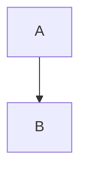

# Redmine Mermaid Macro plugin 完整說明文件

## 項目概述

本插件在 Wiki 格式欄位顯示 Mermaid 圖表。目前同時支援原本的 {{mermaid …}} 巨集與 Markdown/CommonMark 的 mermaid 程式碼區塊。
兩種語法共用前端繪圖程式，可在同頁混用，也會處理動態插入的預覽內容。

- 插件 ID：`redmine_mermaid_macro`
- 版本：1.2.0
- 作者：Taiki IKEGAME
- 授權：MIT（依目錄 LICENSE）。
- 核對日期：2026/10/01
- 核對環境：Redmine 5.1.1.stable，文字格式為 CommonMark。

---

## 主要功能

- 支援 {{mermaid …}} 巨集，適用於 Redmine 支援巨集的 Wiki 格式欄位。
- 支援 Markdown/CommonMark 的 mermaid fenced code block；巨集與區塊可混用。
- 辨識 `.wiki pre > code[data-language="mermaid"]` 與 `.wiki pre > code.language-mermaid`。
- 按需載入引擎；沒有圖表的頁面不會下載 Mermaid 與 ELK 模組。
- Mermaid 初始化一次，同頁圖表依序繪製，避免同時渲染衝突。
- MutationObserver 偵測動態插入的 Redmine/視覺化編輯器預覽。
- 以 WeakSet 與 data-processed 避免重複處理，略過已移除的節點。
- 圖表失敗時保留來源並記錄 Console 錯誤，後續圖表可繼續處理。

---

## 檔案結構 (Tree Structure)

```text
redmine_mermaid_macro/
├── init.rb  # 登記 1.2.0、Mermaid URL 設定與 mermaid 巨集
├── lib/
│   └── mermaid_macro_hook.rb  # 頁首加入 CSS、JSON 跳脫後的 importmap
├── assets/
│   ├── javascripts/
│   │   └── redmine_mermaid_macro.js  # 辨識巨集/語言標記
│   └── stylesheets/
│       └── redmine_mermaid_macro.css  # 保留 task 矩形高度設定
├── app/
│   └── views/
│       └── settings/
│           └── _redmine_mermaid_macro_settings.html.erb  # 設定 Mermaid ESM URL
└── LICENSE  # MIT License
```

---

## 檔案詳細說明

- `init.rb`：登記 1.2.0、Mermaid URL 設定與 mermaid 巨集；巨集輸出有唯一 ID 的 div.mermaid，繪圖由共用資產處理。

- `lib/mermaid_macro_hook.rb`：頁首加入 CSS、JSON 跳脫後的 importmap，以及 type=module 的共用繪圖 JavaScript。

- `assets/javascripts/redmine_mermaid_macro.js`：辨識巨集/語言標記，讀取純文字、轉換容器，以共用 Promise 初始化 Mermaid/ELK，序列化繪圖並監聽新增 DOM。

- `assets/stylesheets/redmine_mermaid_macro.css`：保留 task 矩形高度設定，讓尚未處理或錯誤的圖保留原始文字換行。

- `app/views/settings/_redmine_mermaid_macro_settings.html.erb`：設定 Mermaid ESM URL。

- `LICENSE`：MIT License，原作者 Taiki IKEGAME。

---

## 安裝與設定

1. 複製目前的 redmine_mermaid_macro 目錄到 plugins/，重載 Redmine；沒有 Migration。
2. 管理員進入「管理 → 插件 → Redmine Mermaid Macro plugin → 設定」。
3. 設定可由瀏覽器載入的 Mermaid ESM URL，儲存後重新整理頁面。
4. 使用 Markdown 區塊時，Redmine 文字格式須為 Markdown 或 CommonMark；本環境為 CommonMark。

設定鍵為 mermaid_url，原始碼預設為：
`https://cdn.jsdelivr.net/npm/mermaid@11.16.1/dist/mermaid.esm.min.mjs`。
既有儲存的設定優先於原始碼預設；ELK 模組 URL 目前固定在 JavaScript 內，版本為 0.2.2。

---

## 使用技術與實作邏輯

Macro 只建立 div；View Hook 在完整頁面載入共用 module，importmap 將 mermaid 對應到設定 URL。
CommonMark/Markdown 先把 fenced block 轉成帶語言標記的 code；共用 script 讀取 textContent，替換為 div.mermaid。
初始化使用 startOnLoad: false，註冊 ELK layout loaders；現行程式沒有把 layout 預設強制設為 elk。
所有節點共用 __redmineMermaidReady 與 __redmineMermaidQueue；保留與舊快取中的 inline 巨集程式共用的相容處理。

視覺化編輯器 iframe 內保留可編輯程式碼；切到「預覽」才由共用繪圖程式產生 SVG。
redmine_wysiwyg_editor 的本地修改會讀取 data-language，避免切換模式丟失 mermaid 標記，見其說明文件。
發佈內容只包含目前使用的 init.rb，排除目錄中的歷史備份。

---

## 使用統計與效能

- 資料庫：僅原生 settings 中的 mermaid_url；沒有額外資料表。
- 伺服器：輸出巨集/Markdown HTML，圖表解析及 SVG 生成在瀏覽器執行。
- 瀏覽器：圖表越多或越複雜，處理時間與資源需求越高；序列化是依序執行，不是快取所有渲染結果。
- 外部依賴：瀏覽器要能載入設定的 Mermaid、固定 ELK 及其相依模組。
- 2026/09/30 已以本環境驗證兩種語法、Textile 巨集、預覽替換、錯誤恢復與避免重繪；本次文件核對沒有再次執行這些瀏覽器測試。

---

## 最佳實踐建議

- 將圖表內容分成完整的多行區塊，保留 mermaid 語言標記。
- 在瀏覽器預覽確認語法與圖表結果；錯誤時查看 Console 的 Mermaid render failed。
- 使用與 API 相容的 ESM 發行版本；僅改 URL 不會改變固定 ELK 版本。
- 需要靜態 HTML 報告時可先匯出 SVG，因 HTML 附件預覽停用腳本。

---

## 範例與常見設定

### 巨集

```text
{{mermaid
flowchart TD
  A --> B
}}
```

### Markdown/CommonMark

````markdown

````

這兩段可放在同一個支援 Wiki 格式的頁面。一般 code 區塊及以更長 fence 包住的語法範例，維持程式碼顯示。

---

## 安全性與權限

- 沒有新權限或選單；觀看圖表沿用其問題、Wiki 或其他內容的權限。
- Mermaid URL 設定由管理員管理；實際程式在讀者瀏覽器中載入並執行。
- 初始化沒有自訂 securityLevel，使用載入版本的引擎預設；本文不宣稱額外的 HTML 消毒機制。
- Markdown 圖表以 textContent 複製來源；頁首 importmap 採 JSON 跳脫。

---

## 故障排除

- 區塊只顯示程式碼：確認文字格式為 Markdown/CommonMark、語言為 mermaid，以及共用 module 已載入。
- 圖未出現：檢查 importmap、ESM/CORS、網路與固定 ELK 模組是否載入成功。
- 失敗後保留原始碼：這是錯誤處理行為，請修正圖表語法並重新預覽。
- 視覺化編輯區未即時畫圖：切到預覽，編輯區保留的是來源。
- ELK 沒有自動套用：程式只註冊 loader，沒有把全域 layout 設為 elk。

```text
/plugin_assets/redmine_mermaid_macro/javascripts/redmine_mermaid_macro.js
/plugin_assets/redmine_mermaid_macro/stylesheets/redmine_mermaid_macro.css
```

---

## 系統要求

- 目前核對 Redmine 5.1.1；插件 init.rb 沒有最低版本限制。
- 瀏覽器須支援 importmap、ES modules、動態 import、Promise、WeakSet 與 MutationObserver。
- 設定的引擎須支援 registerLayoutLoaders 與 run API。

---

## 版本異動記錄

### v1.2.0（現行登記版本，本地更新於 2026/09/30）

加入 fenced Mermaid、共用繪圖、動態預覽與失敗來源保留；合併頁首 Hook 的 CSS/importmap/module 載入。
原作者與 MIT 授權保留。此紀錄描述目前本地程式，不代表上游倉庫發布了相同變更。

---

**版本**：1.2.0  
**作者**：Taiki IKEGAME  
**最後更新**：2026/10/01
